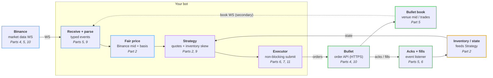

# HFT for dummies

Code for the *HFT for dummies* series: a market maker that quotes SOL-USD on
[Bullet](https://app.bullet.xyz/trade?r=HFT4DUMMIES), priced off Binance's SOL
perpetual future (perp). Each post is one change to this repo.

It can also quote ETH and BTC, and trade on
[Hyperliquid](https://app.hyperliquid.xyz) instead of Bullet, still priced off
Binance: see [Other markets](#other-markets).

> Market making can lose money. The bot starts in **dry run**: no key, no
> orders.

## What we're building



Binance moves, we reprice, requote on Bullet, and fills feed back into
inventory. The series makes that loop fast: from a Binance update to our new
order resting on Bullet.

## Run it

Needs [Rust](https://rust-lang.org/install.html). Tested on Mac and Linux.

```sh
cargo run
```

After a minute of warm-up it quotes, on paper:

```text
quoting
paper: place side=Buy price=100.556 size=0.05
paper: place side=Sell price=100.758 size=0.05
mid 100.656 | fair 100.6573 | our bid 100.556 ask 100.758 | position 0 | pnl $0 (fees $0)
```

Settings are in `bot.toml`. Using a coding agent? Ask it to *"set me up and
run the bot"*; `AGENTS.md` has its instructions.

### Other markets

`bot.toml` is SOL on Bullet. The other combinations each have a config in
[`configs/`](configs/), all on dry run as shipped:

| Market | Bullet | Hyperliquid |
|--------|--------|-------------|
| SOL | `cargo run` | `cargo run -- run configs/hyperliquid-sol.toml` |
| ETH | `cargo run -- run configs/bullet-eth.toml` | `cargo run -- run configs/hyperliquid-eth.toml` |
| BTC | `cargo run -- run configs/bullet-btc.toml` | `cargo run -- run configs/hyperliquid-btc.toml` |

One bot quotes one market. To quote several at once, run several bots, one
terminal each; each config has its own metrics port. At startup the bot checks
the market exists and the order size is allowed there (Hyperliquid: at least
$10 an order), and says what to change if not.

A config picks its exchange with `venue = "bullet"` (the default) or
`venue = "hyperliquid"`. On Hyperliquid, `symbol` is the coin (`"ETH"`), not
`"ETH-USD"`.

## Going live

1. **Deposit $20 USDC** on [Bullet](https://app.bullet.xyz/trade?r=HFT4DUMMIES)
   (referral code `HFT4DUMMIES`).
2. **Make the bot a key:** `cargo run -- keygen`. It writes `bot.key`
   (git-ignored) and prints a link to
   [Delegate Accounts](https://app.bullet.xyz/delegate-accounts) with the
   key filled in: click **Confirm Delegation**. A delegate can trade but
   never withdraw.
3. **Run it live:** `cargo run -- --live`. Two orders appear either side of
   the price, marked ▸ in the app's order book (set its
   granularity to 0.1 or finer). Ctrl-C cancels them.

Limits in `bot.toml`: at most 0.1 SOL held, stops after a $2 loss. Stopping
doesn't close your position, and the bot cancels any SOL-USD orders you
place by hand on the same account. The same goes for ETH-USD and BTC-USD with
their configs: `cargo run -- run configs/bullet-eth.toml --live`. They share
`bot.key`.

### Going live on Hyperliquid

1. **Deposit $50 USDC** on [Hyperliquid](https://app.hyperliquid.xyz) (perps
   balance). Orders there must be worth at least $10, so the positions are
   bigger: up to about $30 per market with the shipped configs.
2. **Make the bot a key:** `cargo run -- keygen --venue hyperliquid`. It writes
   `hyperliquid.key` (git-ignored) and prints its address. In the app's
   [API page](https://app.hyperliquid.xyz/API), paste that address as the API
   wallet, name it, and click **Authorize**. Like a Bullet delegate, an API
   wallet can trade but never withdraw. Approvals expire: renew it there.
   Already made one in the app? Paste its private key into `hyperliquid.key`.
3. **Run it live:** `cargo run -- run configs/hyperliquid-sol.toml --live`
   (or `-eth`, `-btc`). Ctrl-C cancels its orders.

Differences from Bullet, all handled by the bot:

- Hyperliquid orders don't expire, so the bot keeps a *dead man's switch*
  armed: if it dies without cancelling, Hyperliquid cancels its orders 30s
  later. If Hyperliquid won't arm it, the bot warns you and carries on; then
  cancel by hand in the app after a crash.
- Each account gets 10,000 requests, then one more per $1 traded. The configs
  requote at most every 2 seconds, but a long run at these sizes can still use
  them up. The bot then gets refusals; watch the log.
- Running several coins? Give each bot its own **sub-account**: each has its
  own 10,000 requests, and they share your account's fee tier. Create them on
  the app's Sub-Accounts page, move some USDC to each, and set `sub_account`
  to its address in that coin's config. The same `hyperliquid.key` trades all
  of them.
- Prices allow 5 significant figures, so the price step changes with the price
  (0.001 below $100, 0.01 above).

## The code

Feeds turn the world into **events**, the market maker answers with
**intents**, an executor carries them out.

| File | |
|------|--|
| `src/events.rs` | Every `Event` in and `Intent` out. Start here. |
| `src/bot.rs` | The loop that wires it together |
| `src/binance.rs`, `src/bullet.rs` | Feeds; `bullet.rs` also sends orders |
| `src/hyperliquid.rs` | Hyperliquid's feeds and orders: the same job as `bullet.rs` |
| `src/hyperliquid_sign.rs` | Signing Hyperliquid requests, checked against the official SDK |
| `src/book.rs` | Our copy of the Bullet order book |
| `src/fair_value.rs` | Binance mid + average gap to the exchange we trade on |
| `src/strategy.rs` | Bid and ask prices: spread, skew, limits |
| `src/market_maker.rs` | Events in, intents out. No I/O, fully tested |
| `src/inventory.rs` | Position and PnL, changed only by fills |
| `src/executor.rs` | Live orders on either exchange (the `Venue` trait), or paper ones in dry run |

## Following along

Each part is one PR on `master`, tagged `part-N`, with a short guide in
[`docs/parts/`](docs/parts/). `git checkout part-N` runs the bot as of that post.

| Part | Post | Guide |
|------|------|------|
| 1 | Introduction: the tick-to-trade loop | — |
| 2 | Hello World | [guide](docs/parts/02-hello-world.md) · [`part-2`](https://github.com/bulletxyz/hft-for-dummies/tree/part-2) |
| 3 | Telemetry and latency measurement | [guide](docs/parts/03-telemetry.md) · [`part-3`](https://github.com/bulletxyz/hft-for-dummies/tree/part-3) |
| 4 | Colocation on AWS | [guide](docs/parts/04-colocation.md) · [`part-4`](https://github.com/bulletxyz/hft-for-dummies/tree/part-4) |
| 5 | Streaming market data | [guide](docs/parts/05-streaming.md) · [`part-5`](https://github.com/bulletxyz/hft-for-dummies/tree/part-5) |
| 6 | Order execution | [guide](docs/parts/06-execution.md) · [`part-6`](https://github.com/bulletxyz/hft-for-dummies/tree/part-6) |
| 7 | Rate limits | coming |
| 8 | Linux tuning | coming |
| 9 | Optimising the hot path | coming |
| 10 | Network optimisation on AWS | coming |
| 11 | Nonce management | coming |

## Scoreboard

The [standard benchmark](docs/parts/03-telemetry.md#the-scoreboard) at the end
of each part, live with `bench-live.toml`: Part 3 on a laptop, the rest on the
Tokyo server over Bullet's direct endpoint. It splits one trip around the loop:

```text
 Binance update ──► reaches us ──► waits in our queue ──► we decide ──► order to Bullet ──► our order is open
                   binance→us         queue             tick-to-trade    order-to-live
 └─────────────────────────────────────── end-to-end ───────────────────────────────────────┘
```

| Part | end-to-end p50 / p99 | Binance → us p50 | tick-to-trade p50 | order-to-live p50 / p99 | queue p99 / max |
|---|---|---|---|---|---|
| 3 (laptop baseline) | 211 / 369 ms | (clock off) | 6 µs | (clock off) | 337 / 657 ms |
| 4 | 26.8 / 110 ms | 1.6 ms | 1 µs | 24.6 / 89 ms | 93 / 350 ms |
| 5 | 25.5 / 121 ms | 1.6 ms | 1 µs | 23.2 / 119 ms | 100 / 540 ms |
| 6 | 5.6 / 71 ms | 1.5 ms | 2 µs | 3.9 / 70 ms | 0.01 / 20 ms |

Every server run used the same machine, Part 8's 4-core c8g.xlarge (Part 4
sets up a c8g.large). Parts 4 and 5 are single 10-minute runs.

Parts 6-11 are each the median of three 5-minute runs, taken in rotation so
every part saw the same conditions at Bullet. One run after another, Bullet's
speed drifted more over an evening than these parts change it. p99 is noisy from run to run.

## Incidents

Things that went wrong while building this live, and what each taught us.
Details in each part's guide.

| Part | Incident | Lesson |
|------|----------|--------|
| 2 | Binance socket went silent, no error | Silence isn't "nothing happened": time out and reconnect |
| 2 | Bullet's websocket dropped a fill | Streams notify, records are truth: reconcile fills |
| 2 | An order filled during shutdown | Check fills once more before reporting |
| 2 | A cancel raced a fill | "Order not found" is normal: plan for it (Part 6 avoids it) |
| 3 | Laptop clock 288 ms behind: messages "from the future" | Sync clocks before measuring across machines |
| 4 | Our latency probe was timing DNS lookups | Know exactly what your tool measures |
| 5 | A 3 s heartbeat timeout fired falsely on wifi | Timeouts trade false alarms against reaction time |
| 6 | Order confirmations arrived before our own request returned | Without waiting, expect any order of events |

## License

Apache-2.0. Not financial advice.
